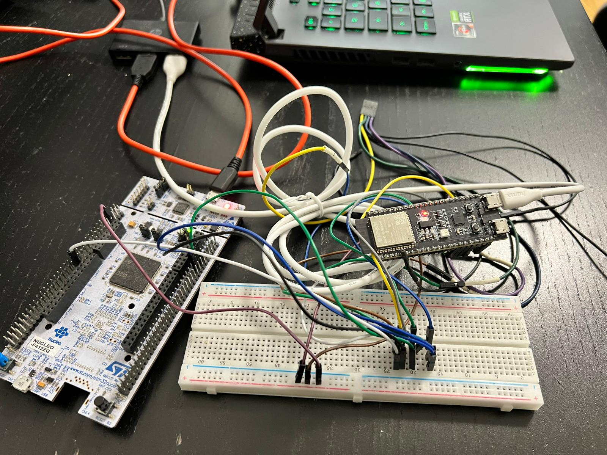
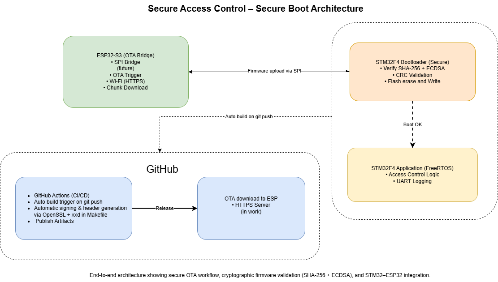

# Secure Access Control – Secure Boot Architecture

## Overview

This project is a DIY embedded system I built to learn about secure firmware design, FreeRTOS, and software updates using bootloader.  
It uses an **STM32F4 microcontroller** as the main controller and an **ESP32-S3** as the Wi-Fi and update module.

The STM32 runs a bootloader that checks the firmware’s integrity using **SHA-256 hash** and **ECDSA signature verification** before running it.  
This ensures that only trusted firmware can run on the device.  
The ESP32 accesses the new firmware from local device and sends it to the STM32 through **SPI**.

On GitHub, a **CI/CD pipeline** automatically builds the firmware, signs it using **OpenSSL**, and creates versioned binary and header files.  
These artifacts are then used by the ESP32 for OTA updates.

The STM32 application runs on **FreeRTOS** and handles basic access-control logic, logging, and communication with external peripherals.

---

### In short, this project taught me how to:

- Work with **FreeRTOS tasks** and inter-task communication  
- Create a **secure bootloader** and firmware validation process  
- Automate firmware builds and signing using **GitHub Actions**  
- Connect and transfer firmware between two MCUs (**ESP32 ↔ STM32**)  

---

## Block Diagram

---

## Implementation

- STM32F4 app runs FreeRTOS with separate tasks for access control and logging  
- Manual FreeRTOS setup without CubeMX  
- Bootloader verifies firmware authenticity using **SHA-256 + ECDSA** before booting  
- ESP32 sends firmware chunks via **SPI**  
- **CRC** is used for chunk validation before writing to Flash  
- **GitHub Actions** builds and signs the firmware automatically using OpenSSL and Makefile  
- **VS Code tasks** for easy build and debug  

---

## Firmware Validation Process

During every boot, the STM32 bootloader verifies the integrity and authenticity of the firmware before execution.  
The firmware image is first hashed using **SHA-256**.  
This hash is then checked against a **digital signature** created during the build process using a private **ECDSA key**.  
The bootloader, which stores the matching **public key** in Flash, uses **mbedTLS** to verify the signature.  
If the verification passes, the firmware is considered genuine, and the system proceeds to boot.

---